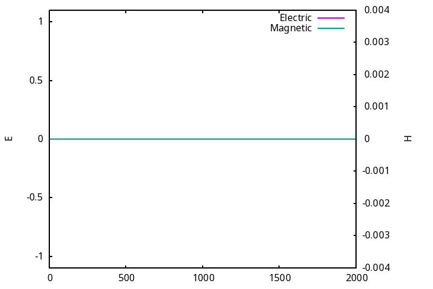
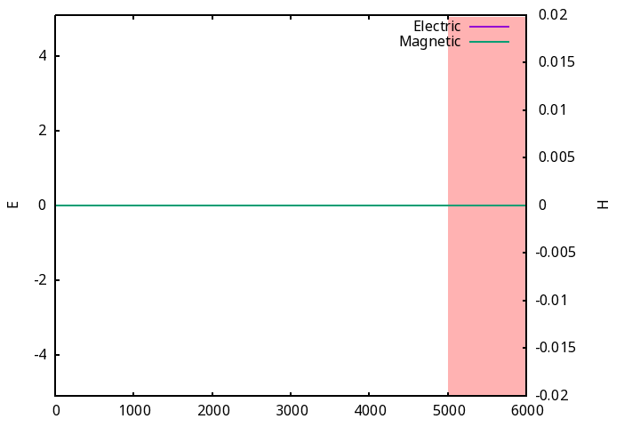
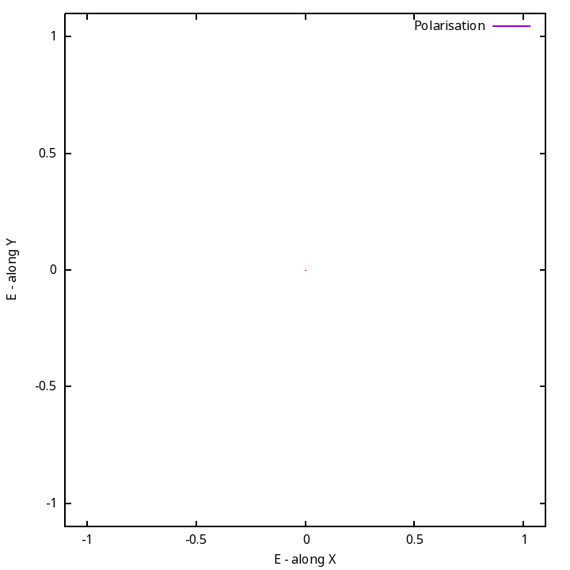

# Part A

To build the programs, you can move to the respective directory (partA/partB/partC) and run make
The basic build steps will look like:

```
git clone https://github.com/ShivaVarunAdicherla/EE3140-PA.git # Cloning the repo
cd EE3140-PA/PA1/PartA && make # Move to problem directory and build
./partA # Execute
```

## The wave evolution over time



---

# Part B 

## The wave evolution over time


# Part C

## The polarisation evolution over time




