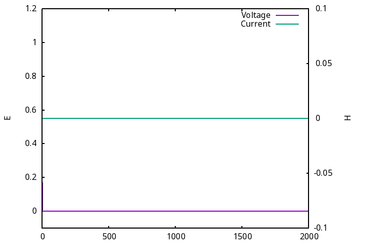

# Part A
This is a python script that requires numpy, and meshio and gnuplot.
The way to run the script is:
```bash
#Move to the Part A directory from the root of directory
cd PA2/PartA
# The TE%d and TM%d section is the mode selection, and this simulator orders them in the eign value order returned by eigh of numpy
# freq is optional, if not specified default to 1Ghz as mentioned
python FEM.py <mesh file> <TE%d>/<TM%d> <freq>

# Examples
python FEM.py rect.msh TE5 1e9
python FEM.py rect.msh TM9 1e9

# Results by default are saved to ./results with the required plots in .pdf format (Primarily for ease of embedding into the report)
cd results
xdg-open heatmap.pdf # Opens the heatmap.pdf in default viewer. Assumes FreeDesktop (Linux)
```

# Part B
This doesn't contain any script/program however, the graphing environment/equations are available in desmos #[at](https://www.desmos.com/calculator/n3dzb8yebg) 

# Part C
This follows a similar setup to the code in PA1, since they are partially duplicates of each other (PartA of PA1)
The way to build and run the program is
```bash
#Move to the Part C directory from the root of directory
cd PA2/PartC/
make buildLossless # Builds the lossless Model
make buildLossy # Builds the lossy Model
make buildDielec # Builds the dielectric Model
```

## Some simulation Live Plots
---
### Lossless Case

---
### Lossy Dielectric Case

